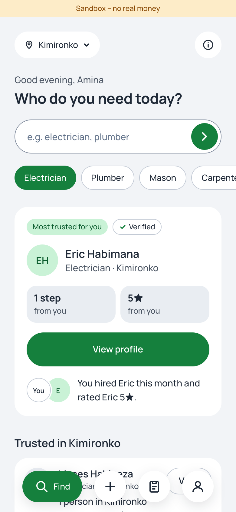
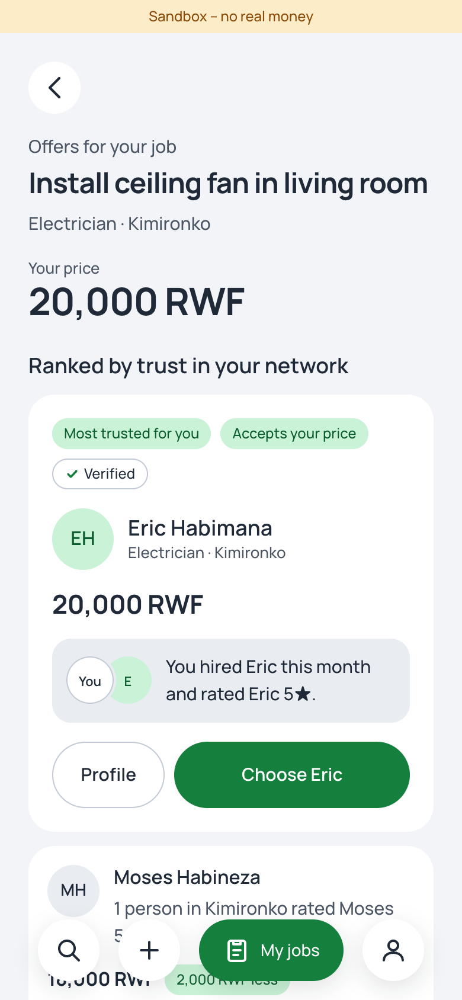
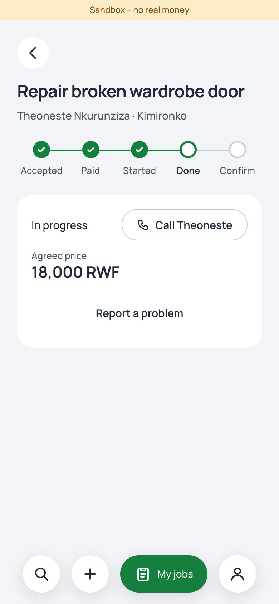
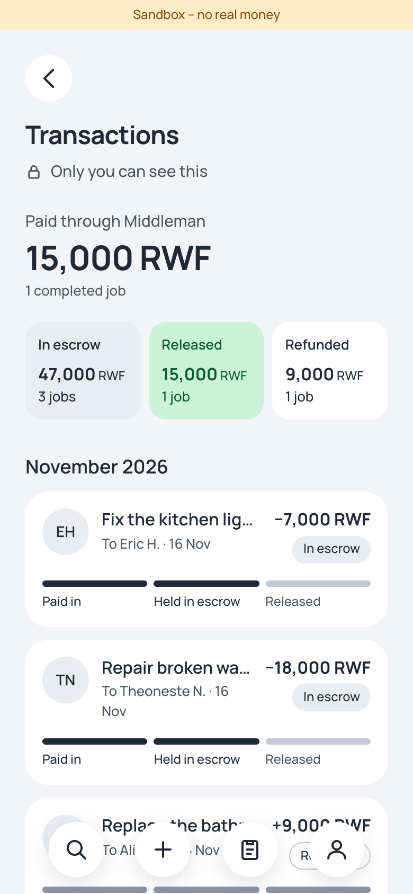
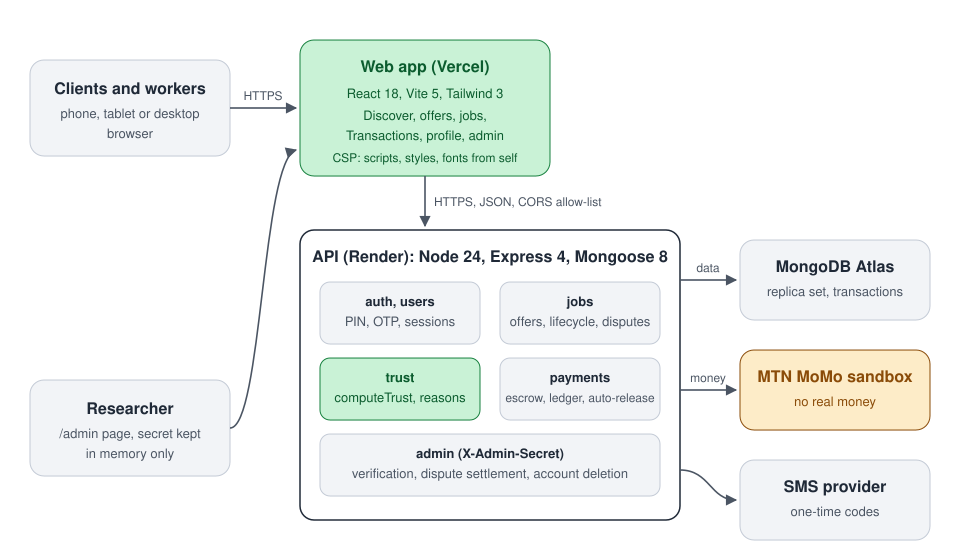

# Middleman

In Kigali's informal labour market, people find electricians, plumbers and
other tradespeople by asking friends and neighbours, because there is no
reliable way to judge a stranger, and paying up front for work that is never
finished is a real risk. Middleman is a responsive web app for four
neighbourhoods (Kimironko, Kwa Nayinzira, Remera, Gikondo). It ranks workers
for each client by **personalised, graph-based trust propagation**: workers
trusted by people the client trusts come first, with a plain sentence saying
why. Ratings go both ways, and payment is held in a **sandboxed mobile-money
escrow** (MTN MoMo sandbox, no real money) until the client confirms the work.
ALU BSc Software Engineering capstone, Ojotule King Attah, supervised by Neza
David Tuyishimire.

| | |
|---|---|
| Live app | https://middleman-client.vercel.app |
| API health | https://middleman-api-74zb.onrender.com/api/health (free host: the first request can take up to a minute to wake it) |
| Demo video | [VIDEO LINK] |
| Final report | [REPORT LINK] |
| Technical report | [TECH REPORT LINK] |
| Android app | [APK LINK] |

**Try it:** log in with phone `0788000001` and PIN `1234` (Amina, a client in
Kimironko), open Discover and pick Electrician, then My jobs → "Install ceiling
fan" to see three offers ranked by trust, not price. Other demo accounts are
listed under [Seed data](#seed-data).

<p>
  
  
  
  
</p>

Discover · offers ranked by trust · a job in progress · Transactions (phone, 390 px).

## The trust algorithm

**What it does.** Every rating and every invitation is an edge in a directed
graph of people. When a client looks for a worker, Middleman searches the
client's own graph for the strongest chain of trust that reaches each worker:
"I rated Amina well; Amina hired Eric and rated him well". Two clients see
different rankings for the same search. There is no global score.

**The rules** (all in one pure function,
[`server/modules/trust/computeTrust.js`](server/modules/trust/computeTrust.js)):

- **Positive evidence:** a 3, 4 or 5 star rating has weight stars ÷ 5. An
  invitation at signup is an edge of weight 1.0.
- **Paths:** up to **3 hops**. A path's score is the product of its edge
  weights; the first hop is not decayed and every later hop is multiplied by
  **0.5**. The **strongest path wins**; paths are never added up.
- **Vouching:** a rating where the client also switched on "Vouch for …" carries ×1.4
  weight and decays by 0.65 instead of 0.5.
- **Negative evidence:** a 1 or 2 star rating is never positive. It counts as
  negative evidence ((3 − stars) ÷ 2), travels at most 2 hops with decay 0.5,
  and the score is max(0, positive − 0.5 × negative).
- **Fallbacks:** with no path, the worker gets **area trust**: the average
  3–5 star rating from people in the worker's own area, × 0.5. With none of
  that, a floor of 0.3 (verified) or 0.1 (not verified). A worker with only
  bad ratings ranks just below an unrated one. Nobody is hidden.
- **Tiers, never numbers:** the app shows "Trusted in your network", "Trusted
  in this area" or "New · not yet rated". The score itself never leaves the
  server.

**Worked example** (the proposal's Table 6; it is a test,
[`server/test/trustPropagation.test.js`](server/test/trustPropagation.test.js)):

| Worker | Path from you | Arithmetic | Score | Tier |
|---|---|---|---|---|
| Eric | You invited Amina; Amina hired Eric, rated Eric 5★ and vouched | 1.0 × (5/5 × 1.4 × 0.65) | **0.91** | Trusted in your network |
| Diane | You hired Diane and rated Diane 4★ (a direct edge, not decayed) | 4/5 | **0.80** | Trusted in your network |
| Jean | No path within 3 hops | area trust, else the floor | ≤ 0.3 | Trusted in this area, or New |

So Eric ranks above Diane, even though Diane is someone you hired yourself:
Amina's vouch is stronger evidence than your own 4★.

**The reason sentence.** The server returns, with each ranked worker, the
path that produced the score ([`server/modules/trust/reason.js`](server/modules/trust/reason.js)),
and the app turns it into one sentence
([`client/src/trustReason.js`](client/src/trustReason.js)):

- Diane: "You hired Diane in March and rated Diane 4★."
- Eric: "You invited Amina. Amina hired Eric, rated Eric 5★ and vouched for Eric."
- Area tier: "3 people in Kimironko rated Moses 4★ or higher."

Every name, star count and month comes from the path itself. Privacy rules:
the first person on the path is named only when their rating of the worker is
already visible on the worker's profile (otherwise "someone you rated 5★"),
and the middle person of a 3-hop path is never named. The overlapping avatars
and the fact tiles on the top card are built from the same path.

Tests: [`server/test/computeTrust.test.js`](server/test/computeTrust.test.js)
(38 tests of the rules), [`server/test/trustPropagation.test.js`](server/test/trustPropagation.test.js)
(the worked example), [`server/test/rankingReason.api.test.js`](server/test/rankingReason.api.test.js)
(rankings and reasons through the API) and
[`client/src/trustReason.test.js`](client/src/trustReason.test.js) (the sentences).

## Benchmark

The core of the algorithm (path propagation, decay, strongest path, the
negative-evidence rule) was tested on the public **Bitcoin OTC** trust network
(35,592 ratings, 5,881 members), with the leave-one-out protocol of Kumar,
Spezzano, Subrahmanian & Faloutsos (2016), "Edge weight prediction in weighted
signed networks" (ICDM): hide one rating, predict it from the rest, report RMSE
(lower is better, 0–2) and Pearson correlation (PCC, higher is better). The
data has no roles, areas, invitations or verification, so those features are
switched off here and evaluated in the pilot instead. No synthetic data.

| Method | RMSE | PCC | Source |
|---|---|---|---|
| **Ours, app defaults** (λ 0.5, 3 hops), all edges | 0.345 | 0.289 | `results/bitcoinotc_2026-10-30T21-03-49-397Z.json` |
| **Ours + community fallback**, all edges | 0.335 | 0.382 | same |
| **Ours, tuned** (λ 1.5, 2 hops, chosen on a 20% split) + community, held-out 80% | 0.325 | 0.439 | `results/bitcoinotc_2026-11-15T13-46-26-449Z.json` |
| **Ours, tuned + calibration**, held-out 80% | 0.316 | 0.473 | same |
| Flat average of the worker's ratings (our baseline) | 0.319 | 0.474 | `results/bitcoinotc_2026-10-30T21-03-49-397Z.json` |
| Kumar et al. FxG (best unsupervised, Table IV) | 0.31 | 0.49 | paper |
| Kumar et al. Goodness | 0.32 | 0.48 | paper |
| Kumar et al. Reciprocal | 0.32 | 0.46 | paper |
| Kumar et al. MDS | 0.35 | 0.41 | paper |
| Kumar et al. TidalTrust | 0.39 | 0.38 | paper |
| Kumar et al. Signed-HITS | 0.37 | 0.34 | paper |
| Kumar et al. Bias & Deserve | 0.36 | 0.32 | paper |
| Kumar et al. PageRank | 0.37 | 0.07 | paper |
| Kumar et al. EigenTrust | 0.37 | 0.01 | paper |

Only the paper's unsupervised Table IV is comparable (its supervised Table V is
not). The path-based method is competitive with the paper's unsupervised
methods, not dominant: on this market most ratings are positive and most
members have three ratings or fewer, which favours simple averages. The app
keeps its defaults (λ 0.5, 3 hops); switching to the tuned values is a
research decision. All five committed runs are in [`results/`](results/)
(aggregate metrics only, `.json` and `.csv`).

Reproduce (about 8 minutes for all edges):

```bash
mkdir -p data/raw
curl -L https://snap.stanford.edu/data/soc-sign-bitcoinotc.csv.gz | gunzip > data/raw/soc-sign-bitcoinotc.csv
cd server
node scripts/experiments/run.js --dataset bitcoinotc --tune-split --reciprocal --seed 1
```

The script checks the file's MD5 (`eeaf5cd1d29ab435505baeeb6816317b`) and line
count, prints which features are switched off, and writes a new
`results/bitcoinotc_<timestamp>.json` and `.csv`. `--sample 2000` gives a quick
check. The dataset is not in the repo (`data/raw/` is ignored).

## Features

Every requirement from the proposal (Tables 3 and 4), with where it lives.
Paths are relative to `server/` or `client/src/`.

| Id | Requirement | Status | Where |
|---|---|---|---|
| FR-01 | Register with name, phone, role, area and PIN; verify the phone once with a code | Delivered (the live site needs an SMS provider switched on; locally the code is printed in the API log) | `modules/auth/auth.routes.js`, `pages/Register.jsx` |
| FR-02 | Workers list their trades | Delivered | `modules/users/user.model.js`, `pages/Register.jsx` |
| FR-03 | Optional referrer at signup, creating a referral edge | Delivered (exact phone match, confirmed by the person, never a name search) | `modules/users/users.routes.js` (`/lookup`), `modules/auth/auth.routes.js` |
| FR-04 | Clients post a job with trade, description, area and price | Delivered | `modules/jobs/jobs.routes.js`, `pages/PostJob.jsx` |
| FR-05 | Workers accept the price or counter it, optionally asking for materials money | Delivered | `modules/jobs/lifecycle.js` (`respond`), `pages/OpenJobs.jsx` |
| FR-05b | Clients see offers ranked by trust and choose one | Delivered | `modules/jobs/lifecycle.js` (`selectResponse`), `pages/JobDetail.jsx` |
| FR-06 | Workers ranked by personalised trust for a trade and area | Delivered (tiers and a reason sentence, never a number) | `modules/trust/discover.routes.js`, `pages/Discover.jsx` |
| FR-07 | Trust computed by graph traversal for any client–worker pair | Delivered | `modules/trust/computeTrust.js`, `modules/trust/trustPropagation.js` |
| FR-08 | Fallback to community (area) trust, then a verification floor | Delivered | `modules/trust/computeTrust.js` |
| FR-09 | Escrow must be funded before work starts | Delivered | `modules/payments/escrow.js` (`fund`), `modules/jobs/lifecycle.js` |
| FR-10 | Release a materials deposit tranche | **Deferred**: paying part of the price out before the work is done weakens the escrow protection the pilot is testing; the materials amount is shown, and the whole price is paid in and released together | — |
| FR-11 | Workers mark a job complete | Delivered | `modules/jobs/lifecycle.js` |
| FR-12 | Clients confirm with a required rating, releasing the money | Delivered | `modules/jobs/lifecycle.js` (`confirmAndRate`), `pages/JobDetail.jsx` |
| FR-12b | Workers rate the client | **Partly**: workers rate the client, but only after the client has confirmed and the money is released, not independently. A rating can then never be used as leverage while the job is still open | `modules/jobs/lifecycle.js` (`rateClient`) |
| FR-13 | Automatic release if the client doesn't confirm | Delivered: 72 hours after the work is marked done, checked at startup, every 15 minutes and when either party opens the job; pays once | `modules/payments/autoRelease.js`, `config/autoRelease.js` |
| FR-14 | Either party raises a dispute, locking the money for admin review | Delivered, with a reason from a list and a description | `modules/jobs/lifecycle.js`, `config/disputeReasons.js`, `components/ReportProblem.jsx` |
| FR-15 | A trust edge for every completed, rated job | Delivered | `modules/trust/ratings.js` |
| FR-16 | Admins review verification and disputes | **Partly**: the admin page verifies workers after a manual review by the researcher and settles disputes; there are no uploaded documents to review, because the ethics approval rules out collecting ID documents and photos | `pages/Admin.jsx`, `modules/users/verification.js`, `modules/payments/payments.routes.js` |
| FR-17 | Clients can flag a completed job as "referred" (vouch) | Delivered | `pages/JobDetail.jsx` (confirm and rate), `modules/trust/ratings.js` |
| NFR-03 | Responsive, installable PWA for low bandwidth | **Partly**: responsive on phones, tablets and desktops, light and dark, self-hosted fonts; not installable yet (no web manifest or service worker) | `client/` |

Added during the build:

| Feature | Status | Where |
|---|---|---|
| Call button: client and worker can call each other only while a job is active | Delivered | `modules/jobs/jobs.routes.js` (`otherPartyPhone`), `components/CallButton.jsx` |
| Job limit: a worker holds at most 3 active jobs; a busy worker keeps their place in the offers but can't be chosen | Delivered, enforced inside the transaction that chooses the worker, so two clients choosing at once can't pass the limit | `modules/jobs/workload.js`, `config/workload.js`, `pages/OpenJobs.jsx`, `pages/JobDetail.jsx` |
| Transactions page: money in escrow, released and refunded, failed attempts | Delivered | `modules/payments/transactions.routes.js`, `pages/Transactions.jsx` |
| Admin page: verification, disputes with reasons, account deletion | Delivered | `pages/Admin.jsx` |
| Account deletion, with settled jobs kept for the other party | Delivered | `modules/users/deleteUser.js`, `scripts/deleteUser.js` |
| Worker job search with filters | Delivered | `modules/jobs/feed.js`, `pages/OpenJobs.jsx` |
| Light and dark mode | Delivered | `styles/index.css`, `theme.js` |

## Install and run locally

You need Node.js 24 (`nvm use` reads `.nvmrc`) and MongoDB running as a
**one-node replica set**: ratings and escrow use transactions, which a
standalone MongoDB refuses.

```bash
# 1. MongoDB as a one-node replica set (Docker; or mongod --replSet rs0)
docker run -d --name mongo -p 27017:27017 mongo:7 --replSet rs0
docker exec mongo mongosh --quiet --eval "rs.initiate({_id: 'rs0', members: [{_id: 0, host: 'localhost:27017'}]})"

# 2. Install (server and client are npm workspaces)
npm install

# 3. Settings: copy the example, then set SESSION_SECRET to any long random string
cp server/.env.example server/.env

# 4. Seed data and the API on http://localhost:4000
cd server
MONGO_URI='mongodb://localhost:27017/middleman?directConnection=true' npm run seed
MONGO_URI='mongodb://localhost:27017/middleman?directConnection=true' npm run dev

# 5. In a second terminal, the app on http://localhost:5173
cd client && npm run dev
```

**`npm run seed` wipes the database `MONGO_URI` points at.** Passing
`MONGO_URI` on the command line keeps it on your local database.

### Environment variables (names only)

Values go in `server/.env` locally or in the host's settings, never in the repo.

| Purpose | Names |
|---|---|
| Required | `MONGO_URI`, `SESSION_SECRET` |
| Production | `NODE_ENV`, `CORS_ORIGINS`, `OTP_SECRET`, `PORT` (set by the host), `NODE_VERSION` (Render) |
| Optional | `SESSION_TTL_HOURS` |
| One-time codes | `OTP_PROVIDER` (`console`, `twilio`, `africastalking`); `TWILIO_ACCOUNT_SID`, `TWILIO_AUTH_TOKEN`, `TWILIO_FROM`; `AT_USERNAME`, `AT_API_KEY`, `AT_SENDER_ID` |
| Escrow (sandbox only) | `PAYMENT_PROVIDER` (`fake`, `momo-sandbox`); `MOMO_COLLECTION_SUBSCRIPTION_KEY`, `MOMO_COLLECTION_USER_ID`, `MOMO_COLLECTION_API_KEY`, `MOMO_DISBURSEMENT_SUBSCRIPTION_KEY`, `MOMO_DISBURSEMENT_USER_ID`, `MOMO_DISBURSEMENT_API_KEY`, `MOMO_CALLBACK_URL`, `MOMO_CURRENCY`, `MOMO_SANDBOX_MSISDN` |
| Admin page and routes | `ADMIN_SECRET` (admin routes are off when it is empty) |
| Tests | `TEST_MONGO_URI` (server), `E2E_MONGO_URI` (end-to-end); both must be local and name a test database |
| App (Vercel) | `VITE_API_URL` |

### Seed data

`npm run seed` creates 25 people (6 clients, 19 workers) across the four
areas and 12 trades, 16 completed and rated jobs, open jobs with offers, and
invitations. Every PIN is `1234`.

| Phone | Who | What to look at |
|---|---|---|
| `0788000001` | Amina, client, Kimironko | Discover; My jobs → "Install ceiling fan": offers ranked by trust, not price |
| `0788000004` | Jean Paul, client, Gikondo | Discover: the same search, a different ranking |
| `0788000101` | Eric, electrician, Kimironko | Jobs near you: accept or counter, with the client's tier |
| `0788000118` | Moses, electrician, Kimironko | Trusted in the area, not in Amina's network |
| `0788000119` | Ange, electrician, Kimironko | New, cheapest offer, still ranked last |

### Running the tests

```bash
# Server (node:test). Without TEST_MONGO_URI the API tests are skipped.
# TEST_MONGO_URI must be a one-node replica set (?directConnection=true) whose
# database name contains "test".
cd server
TEST_MONGO_URI='mongodb://localhost:27017/middleman_test?directConnection=true' npm test

# Client (node:test, the pure helpers)
cd client && npm test

# End to end (Playwright): the whole flow on 5 browsers and devices, each
# against a fresh local API and database; HTML report in e2e/playwright-report/
cd e2e && npx playwright install firefox webkit
E2E_MONGO_URI='mongodb://localhost:27017/middleman_e2e?directConnection=true' npm test

# Ranking regression: the 300 positive-only rankings (25 users × 12 trades)
# must stay identical after any change to the trust code
cd server
MONGO_URI='mongodb://localhost:27017/middleman_regression?directConnection=true' node seed.js
MONGO_URI='mongodb://localhost:27017/middleman_regression?directConnection=true' node scripts/rankingRegression.js
```

## Testing summary

| Suite | Count | What it covers |
|---|---|---|
| Server unit and experiment tests | 109 | The trust rules and worked example, ratings as evidence, session tokens, OTP logging with masked phones, error logs, the MoMo sandbox client (against a stub, never the real API), the experiment code |
| Server API tests (replica set) | 132 | Every route through HTTP: signup and login lockout, Discover rankings and reasons, the job feed, offers and choosing, escrow funding, release, refunds, double-payment races, disputes, automatic release with a test clock, the call-button privacy rule, the active-job limit and two clients choosing at once, Transactions, verification, account deletion, area changes |
| Client tests | 27 | Reason sentences, trust tiles and paths, money and date labels, dispute reasons, phone links |
| End to end | 1 flow × 5 projects, all passing | Register a client and an invited worker, post a job, offer, see the ranked offer with its reason, choose, pay into escrow, call buttons, start, finish, the automatic-release deadline, confirm and rate both ways, earnings, Transactions, and the reason sentence on Discover |
| Ranking regression | 300 rankings | Positive-only rankings on the seed data stay identical |

The cross-browser and device results, and the manual checks on real phones,
are in [`docs/TEST_MATRIX.md`](docs/TEST_MATRIX.md).

## Architecture



### Tech stack

| Part | Versions (exact ones in `package-lock.json`) |
|---|---|
| Runtime | Node.js 24.22.1 (`.nvmrc`, `render.yaml`, `engines: 24.x`) |
| API | Express 4.22.3, Mongoose 8.24.4 (MongoDB driver 6.20.0), helmet 8.3.0, cors 2.8.6, dotenv 16.6.1 |
| Database | MongoDB Atlas in production; MongoDB 7 as a one-node replica set locally |
| App | React 18.3.1, React Router 6.30.6, Vite 5.4.21, Tailwind CSS 3.4.19, Manrope (self-hosted) |
| Tests | node:test (server and client), Playwright 1.56.1 (end to end) |
| Hosting | Render (API), Vercel (app), MongoDB Atlas M0, all free tiers |

### Project structure

```
server/                Express API
  modules/auth/        signup, login, PIN, one-time codes, sessions, rate limits
  modules/users/       profiles, areas, verification, account deletion
  modules/jobs/        jobs, offers, the lifecycle, the worker job feed
  modules/trust/       computeTrust (the pure engine), ranking, reasons, ratings
  modules/payments/    escrow, ledger, automatic release, Transactions, providers (fake, momo-sandbox)
  config/              areas, trades, dispute reasons, auto-release timing
  scripts/             experiments (benchmark), ranking regression, verify or delete a user, MoMo sandbox setup
  test/                server tests
client/src/            React app: pages/, components/, components/ui/ (design system), pure helpers with tests
e2e/                   Playwright end-to-end flow, five browser and device projects
shared/                pilot areas and dispute reasons, copied into server/ and client/ by npm run sync:shared
docs/                  RUNBOOK.md, TEST_MATRIX.md, architecture.svg, screenshots/, designs/
results/               committed benchmark results (aggregate metrics only)
```

## Security and privacy

- **Logins:** 4-digit PIN hashed with scrypt; one-time codes stored only as
  HMAC-SHA256, valid 5 minutes, 5 attempts; signed sessions (HS256) that
  expire after 12 hours; lockout after 5 failed logins per phone or 20 per IP
  in 15 minutes.
- **Transport and headers:** HTTPS only, helmet headers, a strict content
  security policy (scripts, styles and fonts from the app's own origin only),
  CORS limited to the app's address.
- **Money:** sandbox only, never real money. Payments go through the MTN MoMo
  sandbox with participants' numbers never sent: every payer and payee is the
  sandbox test number. Every money movement is an append-only ledger entry
  with an idempotency key, so a double tap, a retry or two checks at once
  never pay twice.
- **Phone numbers:** never shown to other users, with one exception: while a
  job is active (from the client choosing the worker until it is confirmed,
  refunded, settled after a dispute or reopened), its client and its worker
  can see each other's number on the job page to call. Nobody else, no other
  page, and never before or after. In logs, numbers are masked to the country
  code and last 3 digits (+250\*\*\*\*\*123).
- **Data kept to a minimum:** name, phone, role, area, trades, jobs, offers,
  ratings, invitations, hashed PIN and codes. No ID documents, photos, GPS,
  bank or mobile-money account numbers, and no IP addresses stored. Logs and
  exports use ids only. Trust scores are never shown, only tiers.
- **Admin:** the admin page asks for `ADMIN_SECRET` and keeps it in memory
  only; the admin routes are off when it is not set.
- **Account deletion:** removes the person, their ratings, trust edges and
  offers; jobs where money moved stay for the other party, showing "Deleted
  user".

## Licence

No open-source licence has been granted: © 2026 Ojotule King Attah, all rights
reserved. The Manrope font is under the SIL Open Font License 1.1
(`client/src/assets/fonts/OFL.txt`).
